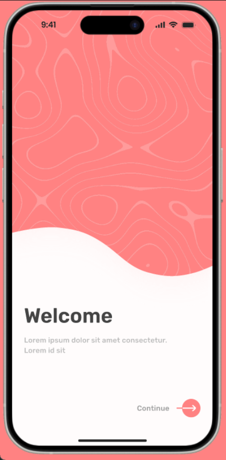
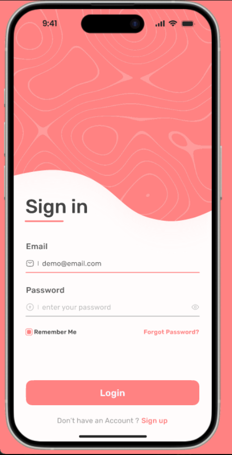
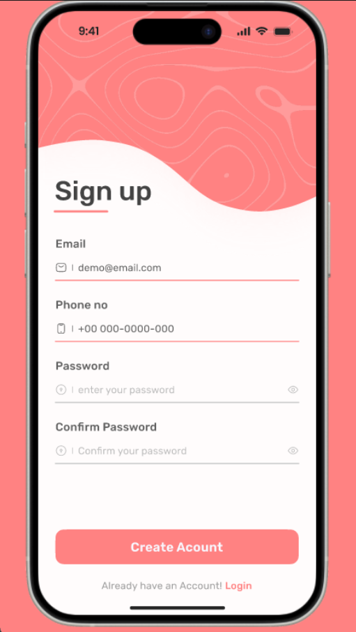

# login_app

A login app built with Flutter - UI only.


## 📌 Features
- Beautiful Welcome, Sign In, and Sign Up screens
- Reusable widgets for text fields and buttons
- Smooth navigation between screens
- Responsive design using ScreenUtil
- Google Fonts integration


## 📱 Screens
| Welcome Screen | Sign In Screen | Sign Up Screen |
|----------------|----------------|----------------|
|  |  |  |


## 🛠️ Tech Stack
- Flutter 3.47.5
- Dart 3.13.4
- Google Fonts
- Flutter ScreenUtil
- Gap
- Material Design


## 📂 Project Structure
```
lib/
├─ core/
│  ├─ widgets/
│  │  ├─ custom_bottom.dart
│  │  ├─ custom_text_field.dart
│  │  └─ text_hint.dart
│  ├─ app_color.dart
│  ├─ images.dart
│  └─ text_styling.dart
├─ screens/
│  ├─ sign_in.dart
│  ├─ sign_up.dart
│  └─ welcome.dart
└─ main.dart
assets/
├─ welcome.png
├─ signin.png
├─ signup.png
├─ click.png
└─ line.png
screenshots/
├─ welcome.png
├─ sign_in.png
└─ sign_up.png
pubspec.yaml
```